# Assignment 03 — Deploy a Static Website to Multiple Servers Using a Multi-Play Ansible Playbook

Part of the DevOps Micro Internship (DMI) with Agentic AI

---

## Student Details

**Full Name:** Kirangandhi Chitturi  
**Cloud Platform Used:** AWS / Azure  
**Server 1 URL:** `http://18.170.121.81/`  
**Server 2 URL:** `http://35.179.143.175/`

---

## Purpose

In this assignment, you will create a multi-play Ansible playbook to install Nginx, deploy a static website to two Ubuntu servers, and verify that the website is accessible from both servers.

You may use either AWS EC2 instances or Azure Virtual Machines as your managed servers.

---

# Task 1 — Create the Project Structure

## Goal

Create the required folders and files for the Ansible project.

## Evidence

### Screenshot 1 — Terminal or VS Code showing the complete `static-web` project structure

- 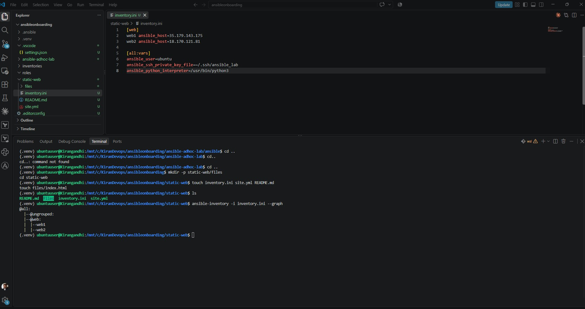
---

# Task 2 — Configure the Ansible Inventory

## Goal

Add both Ubuntu servers to the Ansible inventory.

## Evidence

### Screenshot 2 — Output of `ansible-inventory -i inventory.ini --graph` showing `web1` and `web2`

- 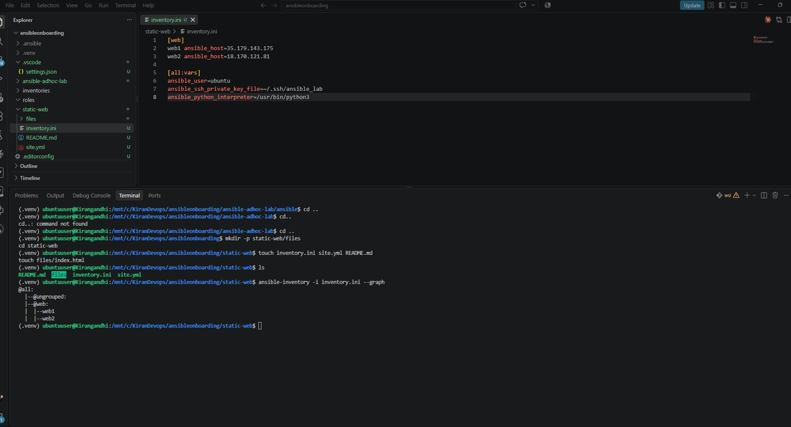
---

## Configuration File

Copy and paste the complete contents of your `inventory.ini` file below:

```ini
[web]
web1 ansible_host=35.179.143.175
web2 ansible_host=18.170.121.81

[all:vars]
ansible_user=ubuntu
ansible_ssh_private_key_file=~/.ssh/ansible_lab
ansible_python_interpreter=/usr/bin/python3

```

---

# Task 3 — Verify Ansible Connectivity

## Goal

Confirm that the Ansible controller can connect to both servers.

## Evidence

### Screenshot 3 — Ansible ping output showing `SUCCESS` and `pong` for both servers

- 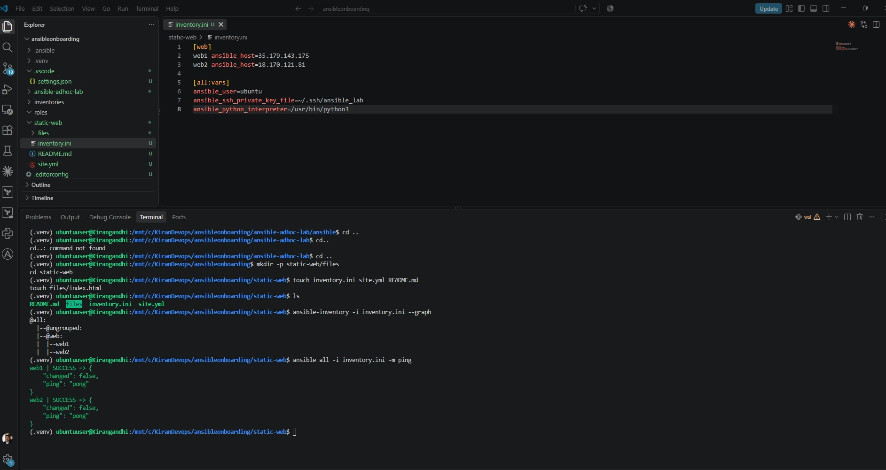
---

# Task 4 — Download and Personalize the Static Website

## Goal

Download `index.html` to the Ansible controller and personalize the website with your full name.

## Evidence

### Screenshot 4 — Edited `files/index.html` showing the footer line with your full name

- 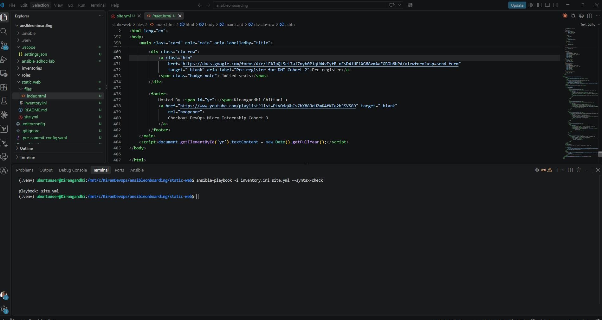
---

# Task 5 — Create the Multi-Play Ansible Playbook

## Goal

Create a single Ansible playbook containing separate plays for installation, deployment, and verification.

## Configuration File

Copy and paste the complete contents of your `site.yml` file below:

```yaml
---
# PLAY 1: Install and configure Nginx
- name: Play 1 - Install Nginx
  hosts: web
  become: true

  tasks:
    - name: Install Nginx
      ansible.builtin.apt:
        name: nginx
        state: present
        update_cache: true
        cache_valid_time: 3600

    - name: Ensure Nginx is running and enabled
      ansible.builtin.service:
        name: nginx
        state: started
        enabled: true

# PLAY 2: Deploy static website
- name: Play 2 - Deploy website
  hosts: web
  become: true

  tasks:
    - name: Copy index.html to Nginx directory
      ansible.builtin.copy:
        src: files/index.html
        dest: /var/www/html/index.html
        owner: root
        group: root
        mode: "0644"
      notify: Reload Nginx

  handlers:
    - name: Reload Nginx
      ansible.builtin.service:
        name: nginx
        state: reloaded

# PLAY 3: Verify website from controller
- name: Play 3 - Verify websites
  hosts: localhost
  connection: local
  gather_facts: false

  tasks:
    - name: Verify HTTP 200 from both web servers
      ansible.builtin.uri:
        url: "http://{{ hostvars[item].ansible_host }}"
        method: GET
        status_code: 200
        return_content: true
      loop: "{{ groups['web'] }}"
      register: website_results
      changed_when: false

    - name: Display website verification results
      ansible.builtin.debug:
        msg: "{{ item.item }} returned HTTP {{ item.status }}"
      loop: "{{ website_results.results }}"
      loop_control:
        label: "{{ item.item }}"
```

---

# Task 6 — Validate the Playbook Syntax

## Goal

Check the playbook for YAML or Ansible syntax errors before running it.

## Evidence

### Screenshot 5 — Successful syntax-check output showing `playbook: site.yml`

- 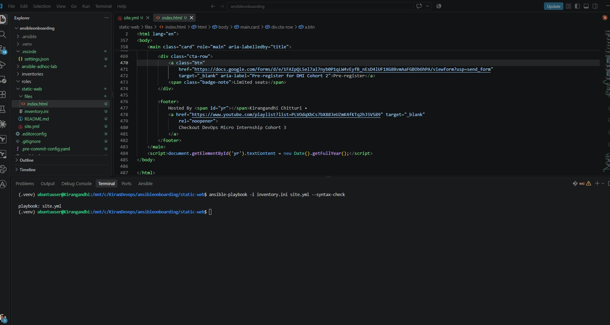
---

# Task 7 — Run the Multi-Play Playbook

## Goal

Install Nginx, deploy the website, and verify both servers in one playbook run.

## Evidence

### Screenshot 6 — Play 3 verification showing HTTP `200` for both servers

- 
---

### Screenshot 7 — Final play recap showing `unreachable=0` and `failed=0` for `web1`, `web2`, and `localhost`

- 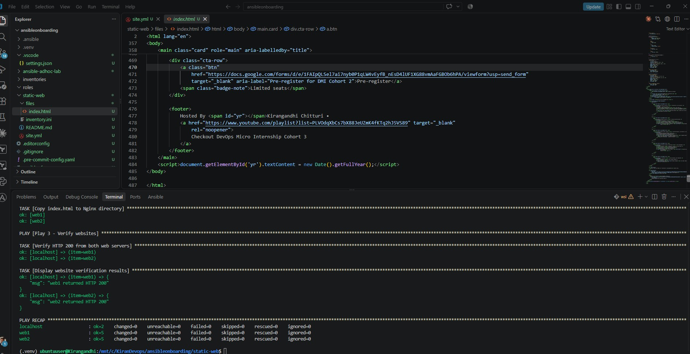

---

# Task 8 — Verify Idempotency

## Goal

Run the playbook again and confirm that it does not make unnecessary changes.

## Evidence

### Screenshot 8 — Second playbook run showing the play recap with `changed=0`, `unreachable=0`, and `failed=0` for both web servers

- 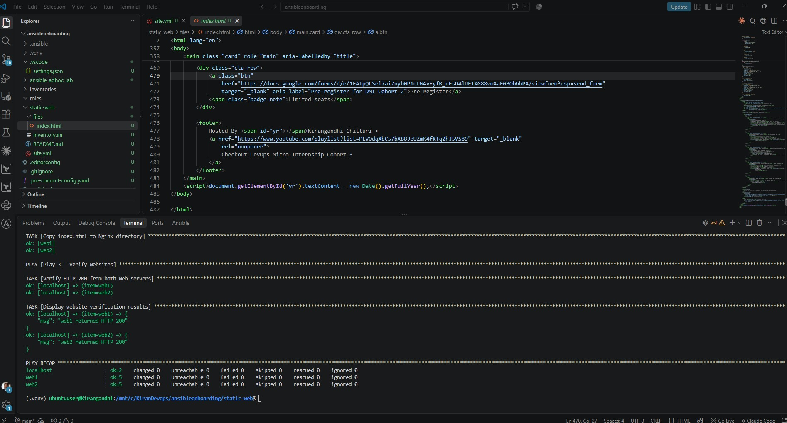

---

# Task 9 — Test Both Websites Manually

## Goal

Confirm that the static website is accessible from both public IP addresses.

## Evidence

### Screenshot 9 — `curl -I` output showing HTTP `200 OK` from both servers

- 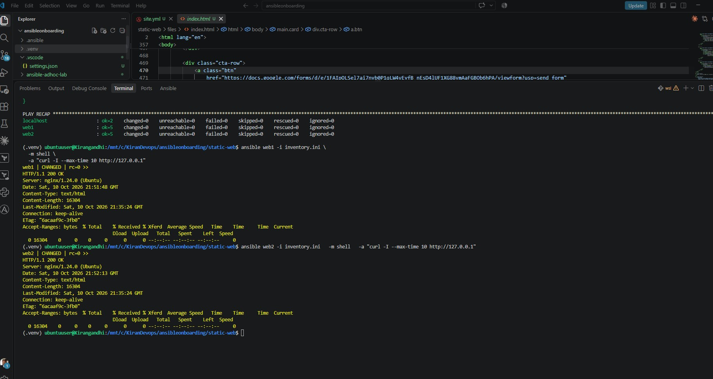

---

### Screenshot 10 — Browser showing the website from Server 1 with the public IP and your full name visible

- 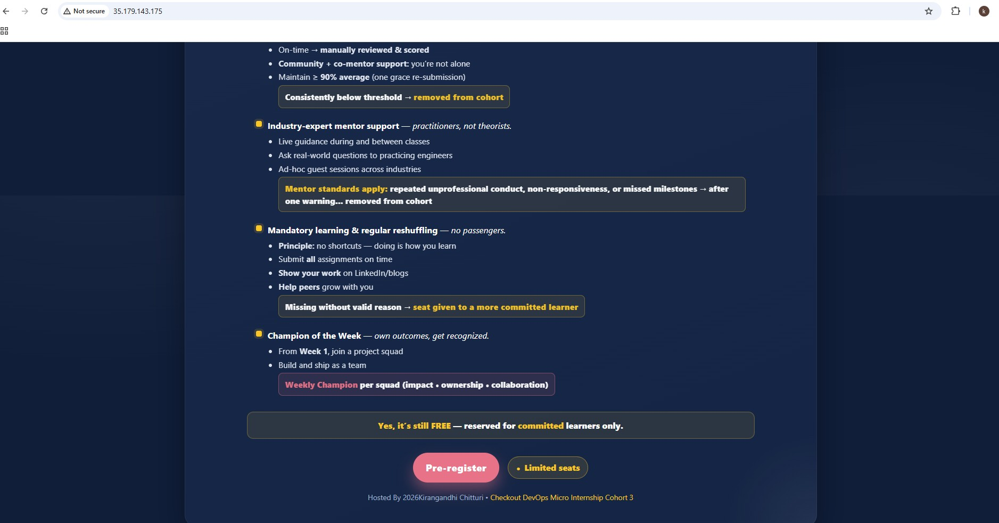

---

### Screenshot 11 — Browser showing the website from Server 2 with the public IP and your full name visible

- 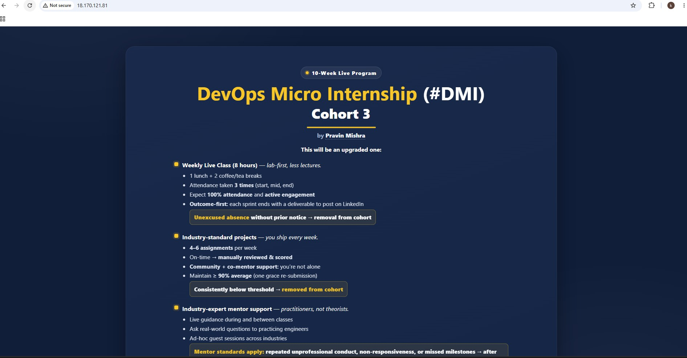

---

## Website URLs

Add both deployed website URLs below:

```text
Server 1: http://35.179.143.175/
Server 2: http://18.170.121.81/
```

---

# Task 10 — Complete the Project README

## Goal

Document how the project works and record what you learned.

## README Content

Copy and paste the complete contents of your `README.md` file below:

```markdown
# Assignment 03 — Static Website Deployment Using Ansible

## DevOps Micro Internship (DMI) — Agentic AI Track

**Student:** Kirangandhi Chitturi  
**Cloud Platform:** AWS  
**Operating System:** Ubuntu Linux  
**Automation Tool:** Ansible  
**Web Server:** Nginx

## 1. Project Overview

This project demonstrates how to automate the deployment of a static website across two AWS EC2 Ubuntu servers using a multi-play Ansible playbook.

The playbook automates three main activities:

1. Install and configure Nginx on both servers.
2. Deploy the same static HTML website using the Ansible `copy` module.
3. Verify website availability from the Ansible controller using the `uri` module.

## 2. Technologies Used

- AWS EC2 — Cloud infrastructure
- Ubuntu Linux — Server operating system
- Ansible — Configuration management and automation
- Nginx — Web server
- HTML/CSS — Static website
- SSH — Secure remote connectivity
- VS Code — Development environment

## 3. Architecture

```text
            Ansible Controller
              (Ubuntu WSL)
                   |
              SSH Port 22
                   |
          -------------------
          |                 |
       Web Server 1     Web Server 2
         (web1)           (web2)
          |                 |
        Nginx             Nginx
          |                 |
       Port 80           Port 80
          |                 |
       Static Website    Static Website
```

Both servers are managed from a single Ansible controller using an inventory file.

## 4. Project Structure

```text
static-web/
├── inventory.ini
├── site.yml
├── README.md
└── files/
    └── index.html
```

**File descriptions:**

- `inventory.ini` — Defines the managed servers and SSH settings.
- `site.yml` — Contains the multi-play Ansible automation.
- `files/index.html` — Static website deployed to both servers.
- `README.md` — Project documentation.

## 5. Ansible Inventory

The inventory contains two Ubuntu servers under the `web` group.

```ini
[web]
web1 ansible_host=35.179.143.175
web2 ansible_host=18.170.121.81

[all:vars]
ansible_user=ubuntu
ansible_ssh_private_key_file=~/.ssh/ansible_lab
ansible_python_interpreter=/usr/bin/python3
```

The public IP addresses should be updated if the EC2 instances change.

## 6. Multi-Play Ansible Playbook

The `site.yml` file contains three separate plays.

### Play 1 — Install and Configure Nginx

- Installs Nginx using the `apt` module.
- Starts the Nginx service.
- Enables Nginx to start automatically after reboot.
- Uses `become: true` for administrative permissions.

### Play 2 — Deploy the Static Website

- Copies `files/index.html` from the Ansible controller.
- Deploys the website to `/var/www/html/index.html` on both servers.
- Sets appropriate file permissions.
- Uses an Ansible handler to reload Nginx when the website file changes.

### Play 3 — Verify Website Availability

- Runs from the Ansible controller using `localhost`.
- Sends HTTP requests to both EC2 public IP addresses.
- Uses the Ansible `uri` module.
- Checks that both websites return HTTP status code `200`.

## 7. Deployment Steps

### Step 1 — Verify Inventory

```bash
ansible-inventory -i inventory.ini --graph
```

### Step 2 — Test SSH Connectivity

```bash
ansible all -i inventory.ini -m ping
```

Both servers should return `SUCCESS` and `pong`.

### Step 3 — Validate Playbook Syntax

```bash
ansible-playbook -i inventory.ini site.yml --syntax-check
```

### Step 4 — Execute the Playbook

```bash
ansible-playbook -i inventory.ini site.yml
```

### Step 5 — Verify Website Availability

```bash
curl -I http://35.179.143.175
curl -I http://18.170.121.81
```

Both servers should return `HTTP/1.1 200 OK`.

### Step 6 — Verify Idempotency

Run the playbook again:

```bash
ansible-playbook -i inventory.ini site.yml
```

If no configuration changes are required, both web servers should report `changed=0`.

## 8. Troubleshooting and Challenges

### Issue — SSH Host Key Verification

During the earlier AWS Ansible setup, SSH host key verification errors occurred when connecting to EC2 instances.

**Resolution:**

Established SSH connections manually and accepted the verified host keys, allowing the Ansible controller to trust the managed servers.

### Issue — HTTP Verification Timeout on web2

During Play 3, the HTTP verification succeeded for `web1` but timed out for `web2`.

**Investigation:**

- Ansible successfully connected to both servers.
- Nginx installation and website deployment tasks completed.
- Confirmed that Nginx was listening on port 80 on `web2`.
- Identified AWS security group HTTP access as an area requiring further verification.

**Status:** The root cause and successful resolution of the HTTP timeout have not yet been confirmed.

## 9. Key Learnings

- Managing multiple EC2 servers using a single Ansible inventory.
- Creating multi-play Ansible playbooks.
- Automating Nginx installation and service configuration.
- Deploying website files consistently using the `copy` module.
- Using handlers to reload services only when necessary.
- Verifying website availability using the `uri` module.
- Understanding idempotency in configuration management.
- Troubleshooting SSH connectivity and HTTP networking issues.

## 10. Website URLs

**Server 1:** http://35.179.143.175

**Server 2:** http://18.170.121.81

These are the EC2 IP addresses used in the lab. Both.
```

---

# LinkedIn Post Required

## Evidence

### LinkedIn Post URL

Paste your LinkedIn post URL here:

https://lnkd.in/p/efzU6Kcd

---

### Screenshot — Published LinkedIn post

- 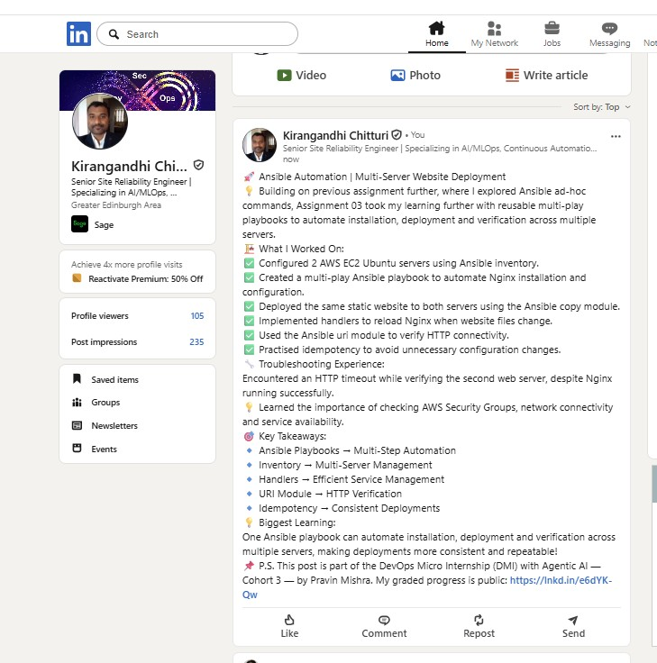

---

# Assignment Questions

Answer the following in your own words:

**1. What issue did you face while completing this assignment, and how did you fix it?**

During the assignment, I encountered an HTTP connection timeout while verifying the website on the second AWS EC2 server (web2).
Although Ansible successfully installed Nginx and deployed the website, the HTTP verification failed. I troubleshot the issue by checking the Nginx service, confirming that port 80 was listening, and investigating AWS Security Group rules and network connectivity.
This helped me understand the importance of both server configuration and network security when deploying applications.

---

**2. What did you learn from this assignment?**

I learned how to create and execute a multi-play Ansible playbook to automate website deployment across multiple AWS EC2 servers.
I also gained practical experience with Ansible inventory, Nginx installation, the copy module, handlers, HTTP verification using the uri module, and idempotency.
Most importantly, I understood how Ansible playbooks make automation more structured, reusable and efficient compared with running individual ad-hoc commands.


---

**3. Why is it useful to split installation, deployment, and verification into separate plays?**

Splitting tasks into separate plays makes the playbook easier to understand, maintain and troubleshoot.
Each play has a specific responsibility: installing Nginx, deploying the website or verifying accessibility.
If something fails, it becomes easier to identify the problem without affecting the other stages.


---

**4. What is one benefit of using the Ansible `copy` module instead of cloning the website directly from Git on every managed server?**

The Ansible copy module allows me to maintain a single version of the website on the Ansible controller and deploy the same files to multiple servers.
This ensures consistency across servers and avoids the need to install Git or configure repository access on every managed server.


---

**5. What does idempotency mean in this assignment?**

Idempotency means running the same Ansible playbook multiple times without making unnecessary changes when the servers are already in the desired state.
For example, after installing Nginx and deploying the website, running the playbook again should not reinstall packages or copy unchanged files.
A successful second run should show changed=0 for both web servers.

---

**6. What does the Ansible `uri` module verify in Play 3?**

The Ansible uri module verifies that the deployed websites are accessible over HTTP.
In Play 3, it sends HTTP requests from the Ansible controller to both EC2 servers and checks whether they return status code 200 OK.
This helps confirm that the websites are responding successfully, rather than just checking whether Nginx is running.

---

# Required Files

Confirm that the following files are included in your assignment folder:

- [ ] `inventory.ini`
- [ ] `site.yml`
- [ ] `files/index.html`
- [ ] `README.md`

---

# Submission Instructions

- Add all required screenshots in the correct order.
- Full Name must be visible in required screenshots.
- Include both deployed website URLs.
- Paste `inventory.ini`, `site.yml`, and `README.md` as editable text.
- Answer all assignment questions clearly in your own words.
- Add your LinkedIn post URL.
- Do not expose SSH private keys, passwords, cloud account IDs, or other sensitive information.

---

# Completion Checklist

- [ ] Task 1: `static-web` folder structure is complete
- [ ] Task 2: Both servers are listed under the `[web]` group in `inventory.ini`
- [ ] Task 2: Inventory graph shows `web1` and `web2`
- [ ] Task 3: Ansible ping returns `SUCCESS` and `pong` for both servers
- [ ] Task 4: `files/index.html` contains your full name
- [ ] Task 5: `site.yml` contains three separate plays
- [ ] Task 5: Play 1 installs, starts, and enables Nginx
- [ ] Task 5: Play 2 deploys `index.html` using the `copy` module
- [ ] Task 5: Nginx reload handler is included
- [ ] Task 5: Play 3 verifies both web servers from the controller
- [ ] Task 6: Playbook syntax check passes
- [ ] Task 7: First playbook run completes with `unreachable=0` and `failed=0`
- [ ] Task 7: URI verification returns HTTP `200` for both servers
- [ ] Task 8: Second playbook run demonstrates idempotency
- [ ] Task 8: Second run shows `changed=0` for both web servers
- [ ] Task 9: Both `curl -I` commands return HTTP `200 OK`
- [ ] Task 9: Website loads from Server 1
- [ ] Task 9: Website loads from Server 2
- [ ] Task 9: Full name is visible on both deployed websites
- [ ] Task 10: `README.md` contains all required explanations
- [ ] Screenshots 1–11 are included
- [ ] `inventory.ini`, `site.yml`, and `README.md` are pasted as editable text
- [ ] Both website URLs are included
- [ ] Assignment questions are answered
- [ ] LinkedIn post published
- [ ] LinkedIn post URL added
- [ ] No sensitive information is exposed

---

## About DMI & CloudAdvisory

DevOps Micro Internship (DMI) is a project-based DevOps program run by Pravin Mishra and The CloudAdvisory, focused on real-world execution, systems thinking, and career readiness.

It helps learners build strong DevOps foundations with hands-on experience.

---

## Resources

- DMI Official Website: [https://dmi.pravinmishra.com?utm_source=github&utm_medium=readme](https://dmi.pravinmishra.com?utm_source=github&utm_medium=readme)
- University: [https://university.pravinmishra.com?utm_source=github&utm_medium=readme](https://university.pravinmishra.com?utm_source=github&utm_medium=readme)
- Discord Community: [https://discord.pravinmishra.com?utm_source=github&utm_medium=readme](https://discord.pravinmishra.com?utm_source=github&utm_medium=readme)
- Blog: [https://dmi.pravinmishra.com/blog?utm_source=github&utm_medium=readme](https://dmi.pravinmishra.com/blog?utm_source=github&utm_medium=readme)
- YouTube Playlist: [https://www.youtube.com/playlist?list=PLFeSNDtI4Cho](https://www.youtube.com/playlist?list=PLFeSNDtI4Cho)
- Pravin Mishra LinkedIn: [https://www.linkedin.com/in/pravin-mishra-aws-trainer/](https://www.linkedin.com/in/pravin-mishra-aws-trainer/)
- CloudAdvisory LinkedIn: [https://www.linkedin.com/company/thecloudadvisory/](https://www.linkedin.com/company/thecloudadvisory/)

---

*This submission is part of DevOps Micro Internship (DMI) — Agentic AI Track.*