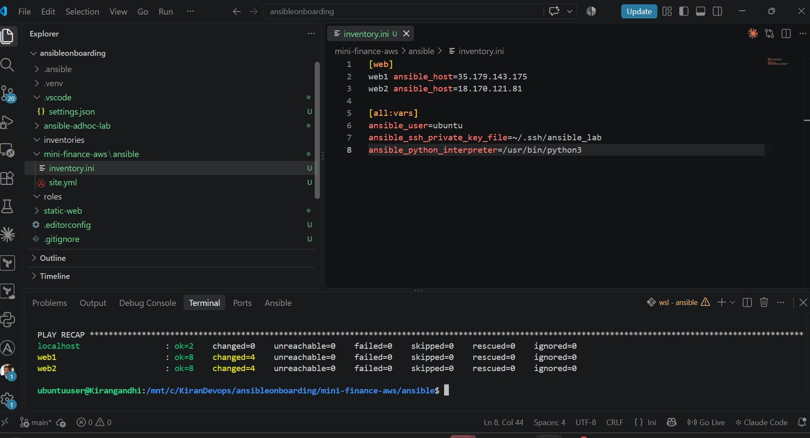
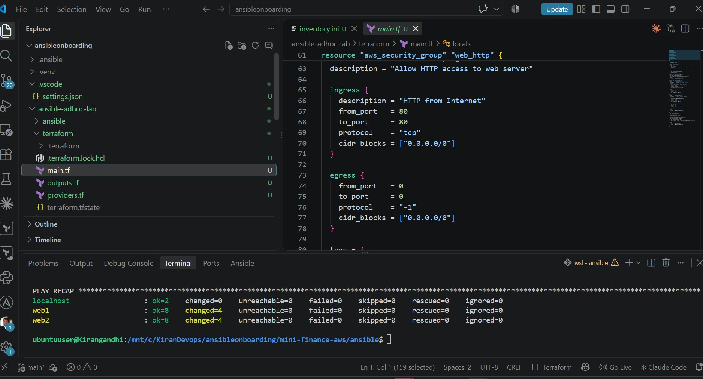
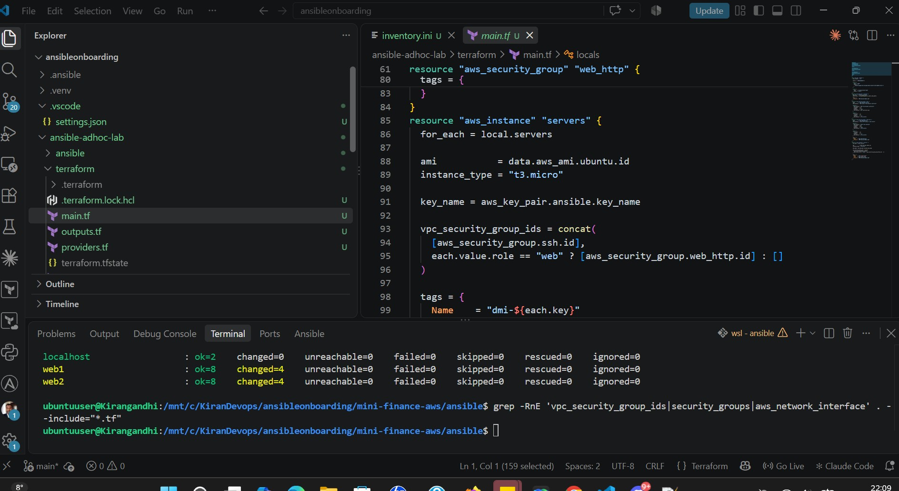
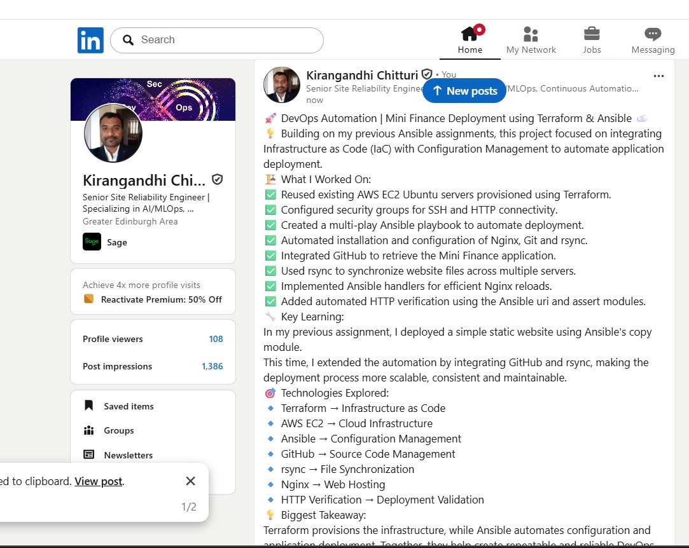

# Assignment 04 — Deploy Mini Finance on Azure Using Terraform and Ansible

Part of the DevOps Micro Internship (DMI) with Agentic AI

---

## Purpose

In this assignment, you will provision Azure infrastructure using Terraform and deploy the Mini Finance website using an Ansible multi-play playbook.

Terraform will create the Azure Virtual Machine and networking resources. Ansible will install Nginx, clone the Mini Finance repository, deploy the website, and verify the deployment.

---


# Task 1 — Create the Project Structure

## Goal

Create separate directories and files for the Terraform infrastructure and Ansible configuration.

### Evidence

#### Screenshot 1 — Terminal or VS Code showing the complete `mini-finance` project structure

- 


---

# Task 2 — Create the Azure Infrastructure Using Terraform

## Goal

Use Terraform to provision an Ubuntu Virtual Machine with the required Azure networking and security resources.

### Evidence

#### Screenshot 2 — Terraform code showing the `Allow-SSH` rule for port `22` and the `Allow-HTTP` rule for port `80`

- 

---

#### Screenshot 3 — Terraform code showing the association between `nsg-mini-finance` and `nic-mini-finance`

- 

# Task 3 — Initialize and Apply the Terraform Configuration

## Goal

Format and validate the Terraform configuration, review the execution plan, and provision the Azure infrastructure.

### Evidence

#### Screenshot 4 — End of the `terraform apply` output showing `Apply complete!` with no errors

Add your screenshot here.

---

#### Screenshot 5 — Output of `terraform output public_ip` showing the VM’s public IP address

Add your screenshot here.

---

### Notes

Add your task notes here.

---

# Task 4 — Verify Passwordless SSH Access

## Goal

Confirm that the Ansible controller can connect to the Terraform-provisioned Azure VM using SSH key authentication.

### Evidence

#### Screenshot 6 — Passwordless SSH command and the returned `mini-finance` hostname

Add your screenshot here.


# Task 5 — Create the Ansible Inventory and Verify Connectivity

## Goal

Add the Terraform-provisioned Azure VM to the Ansible inventory and confirm that Ansible can connect to it.

### Evidence

#### Screenshot 7 — Ansible ping output showing `SUCCESS` and `pong` from the Azure VM

Add your screenshot here.

---

### Configuration File

Copy and paste the complete contents of your `ansible/inventory.ini` file below:

[web]
web1 ansible_host=35.179.143.175
web2 ansible_host=18.170.121.81

[all:vars]
ansible_user=ubuntu
ansible_ssh_private_key_file=~/.ssh/ansible_lab
ansible_python_interpreter=/usr/bin/python3

---

# Task 6 — Create the Multi-Play Ansible Playbook

## Goal

Create one Ansible playbook containing separate plays to install Nginx, deploy the Mini Finance website, and verify the deployment.

### Evidence

#### Screenshot 8 — `site.yml` showing Play 1 and the beginning of Play 2

Screenshot must show:

- Play 1 targeting the `web` group
- Installation of `nginx`, `git`, and `rsync`
- Nginx service configured as started and enabled
- Beginning of Play 2 with the Git repository URL and synchronization task

Add your screenshot here.

---

#### Screenshot 9 — `site.yml` showing the deployment destination, handler, and Play 3 verification

Screenshot must show:

- Website destination `/var/www/html/`
- Ownership set to `www-data:www-data`
- Nginx reload handler
- Play 3 targeting `localhost`
- The `uri` verification and `assert` condition

Add your screenshot here.

---

### Configuration File

Copy and paste the complete contents of your `ansible/site.yml` file below:

---
# PLAY 1 - Install dependencies
- name: Play 1 - Install Nginx Git and rsync
  hosts: web
  become: true

  tasks:
    - name: Install required packages
      ansible.builtin.apt:
        name:
          - nginx
          - git
          - rsync
        state: present
        update_cache: true
        cache_valid_time: 3600

    - name: Start and enable Nginx
      ansible.builtin.service:
        name: nginx
        state: started
        enabled: true

# PLAY 2 - Deploy Mini Finance
- name: Play 2 - Deploy Mini Finance website
  hosts: web
  become: true

  vars:
    repo_url: "https://github.com/kirangandhichitturi/mini_finance.git"
    clone_dir: /opt/mini-finance-source
    website_dir: /var/www/html

  tasks:
    - name: Clone Mini Finance repository
      ansible.builtin.git:
        repo: "{{ repo_url }}"
        dest: "{{ clone_dir }}"
        version: main
        update: true

    - name: Deploy website files using rsync
      ansible.builtin.command:
        argv:
          - rsync
          - -a
          - --checksum
          - --delete
          - --exclude=.git/
          - --itemize-changes
          - "{{ clone_dir }}/"
          - "{{ website_dir }}/"
      register: rsync_result
      changed_when: rsync_result.stdout | length > 0
      notify: Reload Nginx

    - name: Set website ownership
      ansible.builtin.file:
        path: "{{ website_dir }}"
        owner: www-data
        group: www-data
        recurse: true
        state: directory

  handlers:
    - name: Reload Nginx
      ansible.builtin.service:
        name: nginx
        state: reloaded

# PLAY 3 - Verify both websites
- name: Play 3 - Verify Mini Finance deployment
  hosts: localhost
  connection: local
  gather_facts: false

  tasks:
    - name: Verify HTTP 200 from both servers
      ansible.builtin.uri:
        url: "http://{{ hostvars[item].ansible_host }}"
        method: GET
        status_code: 200
        return_content: true
        timeout: 30
      loop: "{{ groups['web'] }}"
      register: website_results
      changed_when: false

    - name: Assert successful deployment
      ansible.builtin.assert:
        that:
          - item.status == 200
          - "'Mini Finance' in item.content"
        success_msg: "{{ item.item }} - Mini Finance verified"
        fail_msg: "{{ item.item }} - Website verification failed"
      loop: "{{ website_results.results }}"

---

# Task 7 — Validate and Run the Ansible Playbook

## Goal

Validate the syntax of the multi-play Ansible playbook and run it to install Nginx, deploy the Mini Finance website, and verify the deployment.

### Evidence

#### Screenshot 10 — Successful playbook syntax check showing `playbook: site.yml`

Add your screenshot here.

---

#### Screenshot 11 — Play 3 output showing the successful HTTP verification and assertion

Add your screenshot here.

---

#### Screenshot 12 — Final `PLAY RECAP` showing `failed=0` and `unreachable=0`

Add your screenshot here.

---

### Notes

Add your task notes here.

---

# Task 8 — Test the Mini Finance Website in a Browser

## Goal

Confirm that the Mini Finance website is publicly accessible through the Azure VM’s public IP address.

### Evidence

#### Screenshot 13 — Mini Finance website successfully loading in the browser, with the Azure VM’s public IP address visible in the address bar

Add your screenshot here.

---

### Website URL

Add your deployed website URL below:

**Server 1:** http://35.179.143.175

**Server 2:** http://18.170.121.81

---

# Task 9 — Create the Project README

## Goal

Create a `README.md` file to document the Mini Finance infrastructure and deployment project.

### Evidence

#### Screenshot 14 — Completed `README.md` displayed in the VS Code Markdown preview or terminal

Add your screenshot here.

---

### README Content

Copy and paste the complete contents of your `README.md` file below:

```markdown
Add your README.md content here.
```

---

# LinkedIn Post Required

## Evidence

#### Screenshot 15 — Published LinkedIn post showing the text and at least one deployment screenshot

- 

---

#### LinkedIn Post URL

Paste your LinkedIn post URL here:

https://lnkd.in/p/eS2pmvZD

---

### LinkedIn Submission Notes

**One challenge you faced and how you fixed it:**

During the assignment, I encountered a Terraform error because the controller_ip variable required a valid CIDR block, but I initially provided only my public IP address. I resolved this by adding /32 to the IP address and passing the correct value to Terraform. This helped me understand how AWS Security Groups use CIDR notation to restrict SSH access securely.

---

**One real-world example where you can use this learning:**

In a real-world environment, I can use Terraform and Ansible together to automate the deployment of websites across multiple cloud servers. Terraform can provision AWS infrastructure and configure security groups, while Ansible can install Nginx, retrieve application code from GitHub, deploy website files using rsync, and verify successful deployment. This approach reduces manual work, improves consistency, and makes deployments faster and more reliable.
---

# Assignment Questions

Answer the following in your own words:

**1. What did you provision using Terraform in this assignment?**

I used Terraform to provision AWS EC2 instances, security groups, and the required networking configuration. Terraform automated the infrastructure setup, including allowing SSH access on port 22 from my public IP address and HTTP access on port 80 from the internet.

---

**2. What did Ansible configure and deploy in this assignment?**

I used Ansible to configure the EC2 servers, install the required packages and Nginx web server, deploy the website files, and verify that the website was accessible. This helped automate the server configuration without manually running commands on each instance.

---

**3. Why is SSH access on port `22` restricted to your public IP address?**

SSH access is restricted to my public IP address for security reasons. This prevents unknown users on the internet from attempting to connect to the EC2 instances and reduces the risk of unauthorised access.

---

**4. Why is HTTP port `80` open to the internet?**

HTTP port 80 is open to the internet so users can access the deployed website through a web browser. It allows incoming web traffic while SSH access remains restricted for security.

---

**5. What is the purpose of the Ansible inventory file?**

The Ansible inventory file contains information about the servers that Ansible needs to manage, such as their IP addresses, SSH usernames, and connection settings. It helps Ansible identify which servers to connect to and execute the playbooks against.

---

**6. Why does the playbook use separate plays for install, deploy, and verify?**

Using separate plays makes the automation easier to understand, maintain, and troubleshoot. The installation play prepares the server, the deployment play copies the website files, and the verification play checks whether the website is working. This separation makes it easier to identify and fix issues.

---

**7. Why is `rsync` useful when deploying website files?**

rsync is useful because it efficiently transfers website files from the local machine to the remote server. It copies only new or modified files instead of transferring everything again, which saves time and reduces unnecessary data transfer.

---

**8. What does the Ansible `uri` module verify in this assignment?**

The Ansible uri module verifies that the deployed website is accessible over HTTP and returns the expected response, such as HTTP status code 200 OK. This confirms that Nginx is serving the website successfully.

---

**9. What issue did you face during this assignment, and how did you fix it?**

During the assignment, I encountered a Terraform error because the EC2 instance configuration referenced an undeclared security group resource named aws_security_group.web_http. I fixed this by reviewing the Terraform configuration, correcting the security group reference, and ensuring the required security group was defined. I then validated the configuration and continued with the deployment.

---

**10. What did you learn from using Terraform and Ansible together?**

I learned how Terraform and Ansible work together to automate infrastructure provisioning and application deployment. Terraform handles creating cloud resources, while Ansible handles server configuration, software installation, and application deployment. Using both tools makes the process more consistent, repeatable, and easier to manage, reducing manual effort and configuration errors.

---

# Required Files

Confirm that the following files are included in your assignment folder:

- [ ] `.gitignore`
- [ ] `README.md`
- [ ] `terraform/providers.tf`
- [ ] `terraform/main.tf`
- [ ] `terraform/variables.tf`
- [ ] `terraform/outputs.tf`
- [ ] `ansible/inventory.ini`
- [ ] `ansible/site.yml`

---

# Submission Instructions

- Add all required screenshots in the correct order.
- Full Name must be visible in required screenshots.
- Add the Azure VM public IP address.
- Add the final Mini Finance website URL.
- Paste `inventory.ini`, `site.yml`, and `README.md` as editable text.
- Answer all assignment questions clearly in your own words.
- Add your LinkedIn post URL.
- Do not expose SSH private keys, passwords, Azure credentials, subscription IDs, Terraform state contents, or other sensitive information.

---

# Completion Checklist

- [ ] Task 1: `mini-finance` project structure created
- [ ] Task 1: `.gitignore` created
- [ ] Task 2: Terraform Azure infrastructure code created
- [ ] Task 2: `Allow-SSH` rule configured for port `22`
- [ ] Task 2: `Allow-HTTP` rule configured for port `80`
- [ ] Task 2: NSG associated with the Network Interface
- [ ] Task 3: `terraform fmt` completed
- [ ] Task 3: `terraform init` completed
- [ ] Task 3: `terraform validate` completed successfully
- [ ] Task 3: `terraform apply` completed successfully
- [ ] Task 3: `terraform output public_ip` displayed the VM public IP
- [ ] Task 4: Passwordless SSH works from the Ansible controller
- [ ] Task 5: `inventory.ini` created
- [ ] Task 5: Ansible ping returns `SUCCESS` and `pong`
- [ ] Task 6: `site.yml` contains three separate plays
- [ ] Task 6: Play 1 installs Nginx, Git, and rsync
- [ ] Task 6: Play 2 clones and deploys the Mini Finance website
- [ ] Task 6: Play 3 verifies HTTP status code `200`
- [ ] Task 7: Playbook syntax check passes
- [ ] Task 7: Ansible playbook completes successfully
- [ ] Task 7: Final recap shows `failed=0` and `unreachable=0`
- [ ] Task 8: Mini Finance website loads in the browser
- [ ] Task 8: Azure VM public IP is visible in the browser screenshot
- [ ] Task 9: `README.md` completed
- [ ] Screenshots 1–15 are included
- [ ] `inventory.ini`, `site.yml`, and `README.md` are pasted as editable text
- [ ] Assignment questions are answered
- [ ] LinkedIn post published with Anyone visibility
- [ ] LinkedIn post URL added
- [ ] No sensitive information is exposed

---

## About DMI & CloudAdvisory

DevOps Micro Internship (DMI) is a project-based DevOps program run by Pravin Mishra and The CloudAdvisory, focused on real-world execution, systems thinking, and career readiness.

It helps learners build strong DevOps foundations with hands-on experience.

---

## Resources

- DMI Official Website: [https://dmi.pravinmishra.com?utm_source=github&utm_medium=readme](https://dmi.pravinmishra.com?utm_source=github&utm_medium=readme)
- University: [https://university.pravinmishra.com?utm_source=github&utm_medium=readme](https://university.pravinmishra.com?utm_source=github&utm_medium=readme)
- Discord Community: [https://discord.pravinmishra.com?utm_source=github&utm_medium=readme](https://discord.pravinmishra.com?utm_source=github&utm_medium=readme)
- Blog: [https://dmi.pravinmishra.com/blog?utm_source=github&utm_medium=readme](https://dmi.pravinmishra.com/blog?utm_source=github&utm_medium=readme)
- YouTube Playlist: [https://www.youtube.com/playlist?list=PLFeSNDtI4Cho](https://www.youtube.com/playlist?list=PLFeSNDtI4Cho)
- Pravin Mishra LinkedIn: [https://www.linkedin.com/in/pravin-mishra-aws-trainer/](https://www.linkedin.com/in/pravin-mishra-aws-trainer/)
- CloudAdvisory LinkedIn: [https://www.linkedin.com/company/thecloudadvisory/](https://www.linkedin.com/company/thecloudadvisory/)

---

*This submission is part of DevOps Micro Internship (DMI) — Agentic AI Track.*